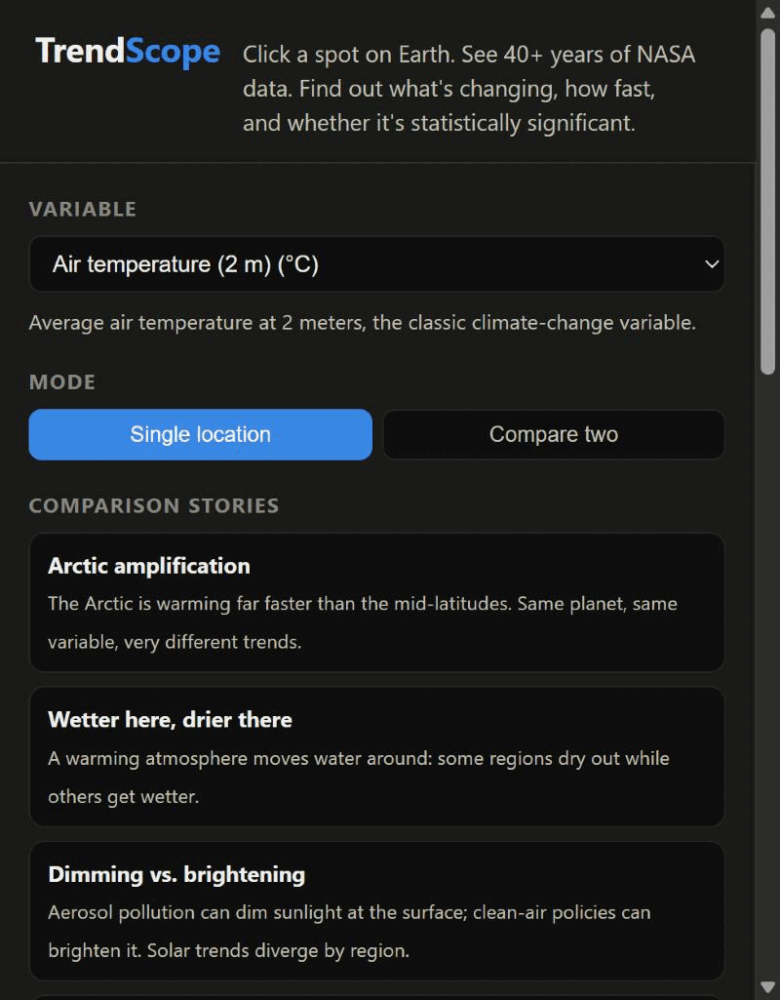

# TrendScope 📈🌍

**What's changing, where is it changing, how much, and is it *significant*?**

TrendScope is a web tool built for the NASA Space Apps Challenge. Click any
point on Earth, pick a variable measured by NASA missions and models, and
TrendScope pulls 40+ years of annual data, charts it, and runs the same trend
statistics climate scientists use to decide whether a change is real or just
noise.

**Live demo:** https://camdengoddard.github.io/SpaceApps/



## The challenge

Change in Earth's interconnected environmental system runs in consistent
directions, but the *same* process can push a variable **up in one region and
down in another**. Arctic air warms several times faster than the global
average while parts of the southeastern US barely warm at all. A warming
atmosphere makes the Mediterranean drier while the Sahel gets wetter. Aerosol
pollution dims sunlight over South Asia while clean-air laws brighten Europe.

With thousands of variables on offer, the hard parts are (1) choosing variables
that could indicate change and (2) analyzing them rigorously. TrendScope makes
both parts point-and-click.

## What it does

- **Select variables.** A curated catalog of 11 variables from NASA POWER
  (temperature, precipitation, humidity, soil moisture, solar irradiance,
  wind, pressure), each annotated with why it matters for change detection.
- **Visualize change over time.** Interactive annual time-series charts
  (1981/1984 through the last complete year) with a hover crosshair and the
  fitted trend line.
- **What and how much.** Sen's slope gives the rate of change per decade and
  the total change over the record, in physical units and percent.
- **Is it significant?** The **Mann-Kendall test** (tie-corrected, the
  standard non-parametric trend test in climate science) produces a p-value.
  Trends with p < 0.05 are flagged significant. Ordinary least-squares
  regression (with a proper t-distribution p-value and r²) cross-checks it.
- **Where is it changing?** A one-click regional scan analyzes a 5x5 grid
  (about 8° across) around your point and paints each cell on the map:
  red = increasing, blue = decreasing, filled = significant, hollow = not.
- **Compare two regions.** Side-by-side analysis on a shared axis, with a
  plain-language summary (for example, "opposite significant trends"). Four
  preset comparison stories demonstrate regional divergence instantly.

## Data & methods

| Piece | Source |
|---|---|
| Time series | [NASA POWER API](https://power.larc.nasa.gov/): MERRA-2 reanalysis + CERES/FLASHFlux solar data, any point on Earth, 1981 to present, no API key |
| Basemap | MapLibre GL JS globe with [NASA GIBS](https://earthdata.nasa.gov/gibs) Blue Marble (+ OpenStreetMap option) |
| Trend test | Mann-Kendall S statistic with tie-corrected variance, then Z, then a two-sided p-value |
| Rate estimate | Sen's (Theil-Sen) slope: median of all pairwise slopes, robust to outlier years |
| Cross-check | OLS regression; p-value from Student's t (regularized incomplete beta), r² |

All statistics are computed **live in the browser**. No build step, no API
keys, no frameworks. The statistics engine is dependency-free and unit-tested
against known critical values.

Because the POWER API does not send CORS headers, browser requests are relayed
through a tiny Cloudflare Worker that forwards GET requests to
`power.larc.nasa.gov` unchanged and adds the `Access-Control-Allow-Origin`
header. The relay adds caching but never modifies the data.

## Running locally

It's a static site. Serve the folder any way you like:

```bash
python3 -m http.server 8000
# then open http://localhost:8000
```

## Project structure

```
index.html        app shell
css/style.css     dark theme + layout
js/stats.js       statistics engine (Mann-Kendall, Sen's slope, OLS, t/beta functions)
js/power.js       NASA POWER client + variable catalog + regional grid scan
js/chart.js       SVG time-series chart with crosshair tooltip
js/app.js         map, UI state, verdict cards, compare mode
```

## Interpreting the output

A **significant** result (p < 0.05) means a monotonic trend this consistent
would arise less than 1 time in 20 from year-to-year noise alone. It does not
by itself identify the cause. A **not significant** result does not mean
"no change". It means the record at that point can't yet distinguish a trend
from variability. Comparing nearby points (the grid scan) shows how the same
process can be unambiguous in one region and undetectable in another.

## Acknowledgements

Data courtesy of the NASA Langley Research Center POWER Project, funded
through the NASA Earth Science Directorate Applied Science Program. Basemap
imagery courtesy of NASA Global Imagery Browse Services (GIBS).

## Environmental intelligence dashboard update

The existing static MapLibre application now includes a UTC day/night globe,
model visualization selector, search, current point estimates, and a historical
NASA POWER timeline. No paid services, API keys, build tools, or server-side
components were added. Existing POWER integration and trend calculations remain.

Run from this folder:

```sh
python3 -m http.server 8000
```

Open http://localhost:8000 and reload once after editing files. Internet access
and WebGL are required for the globe. If WebGL cannot start, coordinate entry
still runs the NASA POWER climate analysis.

### Controls and data meanings

- **Earth:** Sun direction from the current UTC date/time, refreshed every
  minute while the page is visible; a smooth civil-twilight boundary. This is
  an approximate astronomical illumination model, not a live satellite image.
  Blue Marble supplies the historical daytime texture. City lights use the
  NASA VIIRS **2012** composite, restricted to the calculated nighttime side.
- **Wind, Humidity, Solar radiation:** Open-Meteo forecast-model
  estimates. Selected points show temperature, humidity, wind and solar radiation.
  Solar radiation is an interval mean; units and valid timestamps are displayed.
- **Air pollution:** CAMS PM2.5 model estimates through Open-Meteo; not a
  street-level air-quality monitor or a health advisory.
- Environmental overviews use **288 real samples on a 15-degree grid**.
  Scalar fields use bilinear interpolation between real samples. This is
  display smoothing, not added measurement resolution. Missing interpolation
  corners and unsampled polar caps stay unfilled. Wind uses bilinear u/v
  interpolation and 800–2,400 GPU-rendered particle trails, with time
  accelerated and zoom-scaled for visibility through the static valid-time
  field. These are visualized trajectories, not future parcel forecasts.
- Models are fetched lazily, in batches with two requests at a time, cached
  for 15 minutes in memory and up to 30 minutes across reloads within the same UTC valid hour, and never silently substituted with made-up numbers.
  Loading, partial coverage, valid time, and unavailable states are explicit.
  Every global batch requests the same explicit UTC hour using hourly data;
  temperature is explicitly Celsius and nearest grid-cell selection prevents
  default land preference shifting ocean samples. Returned coordinates, valid
  times, units and physical humidity/pollution limits are validated. Invalid
  samples stay unfilled. Their valid times differ from the UTC lighting clock.
- Mode changes cancel pending render jobs, discard the previous tiles, and fade
  in the new source after it finishes loading. A failed source leaves the globe
  unshaded with an unavailable message. PNG generation remains in a worker.
- Weather mode, precipitation/condition summaries and Satellite Clouds have
  been removed, including the MODIS palette and download/compositing code.
- Search uses local Natural Earth country label positions and Open-Meteo /
  GeoNames city geocoding. Country selection goes to a label point, not an
  assertion that a country has a single representative climate.
- The **historical timeline** trims each selected location's real POWER
  annual record through the chosen year and recalculates Mann-Kendall,
  Sen's slope, and OLS using the existing statistics engine. It does not
  invent past global weather maps. Current model overlays and measurements
  are hidden. Lighting previews July 1,
  12:00 UTC of that year, with the static basemap/2012 light texture clearly
  disclosed. **Live Earth** restores today's lighting and the full climate
  record. Full-record regional scans are disabled while a historical cutoff
  is active, so their dates cannot be confused.
- A/B comparison stories, shared-axis charts, chart hover, direct coordinate
  selection, and full-record regional trend scans remain available.

### Rendering and limitations

MapLibre GL JS 5.6.2 remains the rendering library, in spherical
vertical-perspective projection at every zoom. Generated lighting tiles use
MapLibre's raster pipeline, so overlays follow the globe and are naturally
occluded. Labels retain their continent/country/city zoom stages and collision
handling. Rendering is capped at 2x pixel ratio. Lighting is composited from native 256-pixel NASA VIIRS tiles at the
visible zoom, through source level 8. There is no low-resolution global
night atlas. A bounded 96-entry raw-tile cache avoids downloading the same
2012 imagery for every sunlight update. The native imagery limit is about
500–600 m per pixel at the equator; the map limit is 7 minus log2(render
pixel ratio), so Retina displays stop at zoom 6. Raster tile coverage is
adjusted to request the detail required by the display density. This avoids
unsupported overzoom; it cannot provide street-level or building detail. Mercator imagery stretches at the poles. There are no
3D buildings or topographic terrain meshes. No Apple assets are used.

### Files

- `index.html`: dashboard shell, mode selector, search, source attribution,
  measurement panel, and timeline.
- `css/style.css`: responsive dark dashboard, glass controls, accessible focus,
  measurement cards, and existing chart styles.
- `js/app.js`: existing analysis wiring, map hooks, annual cutoff and record cache.
- `js/solar.js`: UTC solar coordinates and altitude calculations.
- `js/earth.js`: lighting compositor and native NASA night imagery.
- `js/environment-data.js`: API access, batching, null handling, caches, search.
- `js/environment-layers.js`: mode transitions and interpolated raster tile orchestration.
- `js/field-grid.js`: bilinear scalar/vector interpolation, missing-data rules, geographic advection.
- `js/field-worker.js`: interpolation and raster PNG encoding off the UI thread.
- `js/wind-particles.js`: custom MapLibre/WebGL globe-aligned, adaptive particle trails.
- `js/dashboard.js`: mode controls, point measurements, search and timeline UI.
- `data/countries.json`: derived Natural Earth country label locations.
- `tests/solar.test.js`, `tests/data.test.js`: offline regression checks.

`js/stats.js`, `js/power.js`, and `js/chart.js` are unchanged.

### Source and usage information

- [NASA GIBS access and usage](https://nasa-gibs.github.io/gibs-api-docs/):
  BlueMarble_ShadedRelief_Bathymetry and VIIRS_CityLights_2012.
  Acknowledge NASA GIBS / ESDIS.
- [Open-Meteo weather API](https://open-meteo.com/en/docs) and
  [air quality API](https://open-meteo.com/en/docs/air-quality-api): model data
  CC BY 4.0; free hosted endpoints are for **non-commercial** use, subject to
  limits (currently 10,000 calls/day) and no uptime guarantee. Multi-location
  requests count as multiple locations. A commercial deployment needs an
  appropriately licensed provider/account; no paid credentials were assumed.
  Credit Open-Meteo and CAMS for air quality.
- [Natural Earth public-domain data](https://www.naturalearthdata.com/about/terms-of-use/),
  country file derived from `ne_110m_admin_0_countries.geojson` in the
  [Natural Earth vector repository](https://github.com/nvkelso/natural-earth-vector).
- [OpenFreeMap](https://openfreemap.org/), OpenMapTiles and OpenStreetMap for
  labels; NASA imagery and OSM street tiles retain visible map attribution.

### Verification

Solar tests check equinox and solstice declination, subsolar daylight, and
antipodal night. Data tests verify valid zero vs missing values, UTC valid time,
point caching, provider failures, no synthesized fallback grids, color scales,
unit/range validation, same-hour bulk requests, and asynchronous layer cleanup. On macOS, run from the project root:

```sh
/System/Library/Frameworks/JavaScriptCore.framework/Versions/A/Helpers/jsc tests/solar.test.js tests/data.test.js tests/field-grid.test.js
/System/Library/Frameworks/JavaScriptCore.framework/Versions/A/Helpers/jsc tests/data-grid.test.js
/System/Library/Frameworks/JavaScriptCore.framework/Versions/A/Helpers/jsc tests/layer-lifecycle.test.js
```

Browser checks cover real global weather and CAMS responses, search, point
measurements, historical cutoff/live reset, comparison records,
regional scan, and desktop/mobile layouts. Public services can fail or change;
the app reports unavailable data rather than replacing it with a simulation.

## Globe quality fixes

The previous night layer mosaicked only 16 low-zoom tiles into a 1024-pixel
world image and enlarged that image at close zoom. Its artificial source
level 4 did not contain any extra detail. The previous scalar renderer drew
solid 30-degree polygons, and wind used one short glyph per sample. These
were the causes of the white blobs, rectangular overlays, and sparse motion.

The replacement requests the NASA night image at the actual visible tile
level and calculates twilight for each output pixel in geographic coordinates.
Blue Marble and night imagery share the same native level-8 coverage and
screen-density-aware zoom ceiling. MapLibre's raster pipeline supplies
power-of-two mipmaps, linear resampling, and engine-managed filtering;
WebGL antialiasing is requested explicitly. Anisotropic filtering support is
managed by MapLibre (its raster path applies it to pitched views when the
extension is available). No CSS sharpening or extra glow was added.

Scalar tiles are generated in a dedicated worker from 15-degree model samples.
Cyclic longitude interpolation removes the antimeridian seam; missing values
are never replaced with zero, and polar coverage is not extrapolated. PNG
rendering resolution is distinct from measurement resolution. The legend
shows sample spacing, coverage, source, valid time, and interpolation.

Particle positions are advected using the interpolated wind components and
stored in world coordinates. Shader projection uses MapLibre 5.6.2's own
spherical projection and clipping plane, keeping particles on the globe and
hiding the back hemisphere. Thin premultiplied-alpha trails avoid glow blobs.
Adaptive density, typed buffers, bounded caches, worker rendering, reduced
motion support, and deferred lighting refreshes during dragging keep the
interaction thread responsive. On the test browser, the 2,400-particle loop
recorded about 0.9 ms of particle CPU work per render; this is not a guarantee
of end-to-end FPS on every device.

The Live Earth button now also resets the timeline label and slider to the
last complete NASA POWER year. Dragging the timeline commits a debounced
historical selection, preventing the slider and displayed record from drifting
apart.

Regression tests additionally cover bilinear midpoints, exact sample retention,
polar bounds, missing corners, dateline continuity, u/v direction conventions,
opposing-vector cancellation, and geographic particle advection. Existing
Mann-Kendall, Sen's slope, POWER retrieval, and SVG chart files are unchanged.

Environmental PNG tiles are also cached (96 entries), so returning to an unchanged mode reuses encoded textures. New tiles warm nearly transparently before fading in, avoiding flashes of the previous field. Wind is at 10 m above the surface; it is not the 250 hPa jet-stream product shown in the Nullschool reference.

The Temperature visualization mode and dashboard navigation shortcuts were removed.
Visualization buttons use text only. NASA POWER temperature trend analysis and
point temperature readings remain available.
